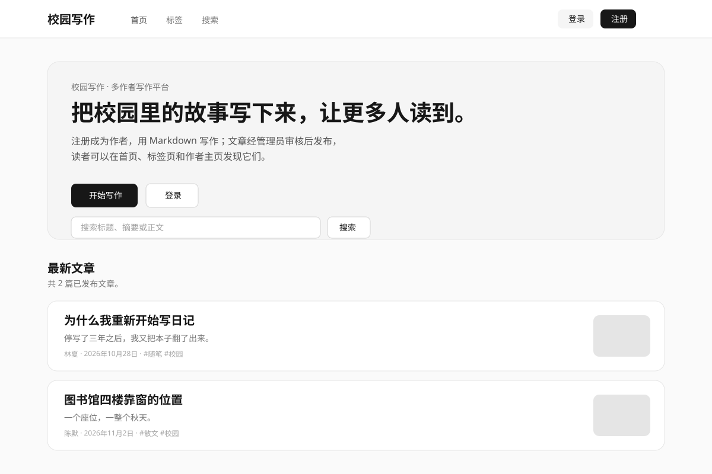
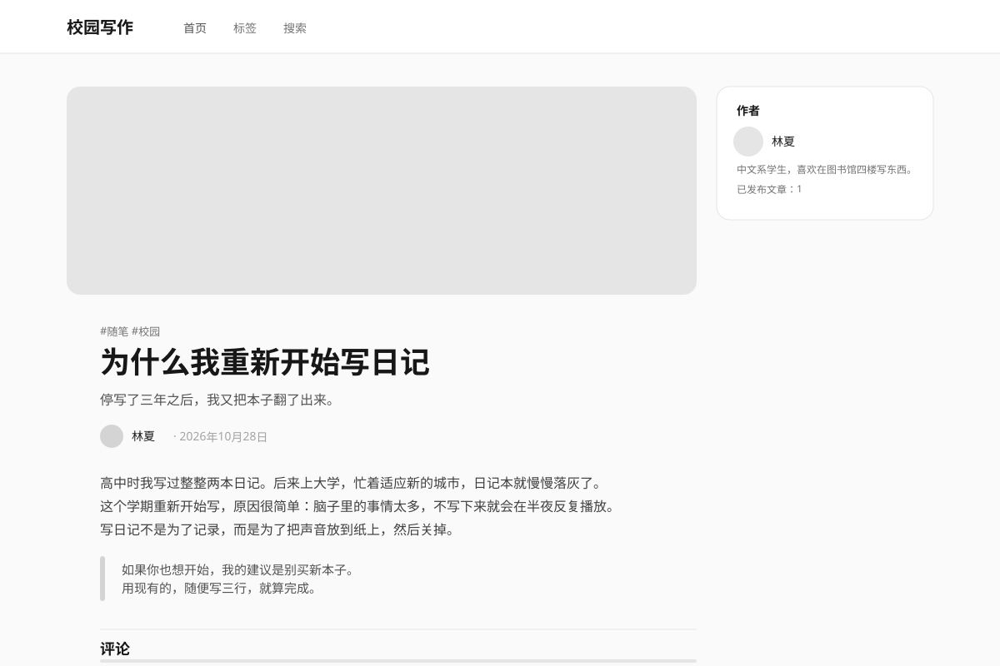
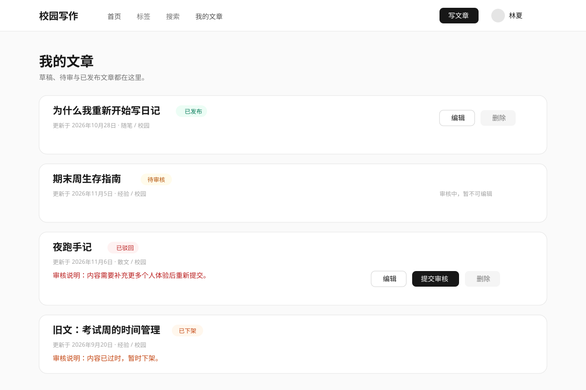
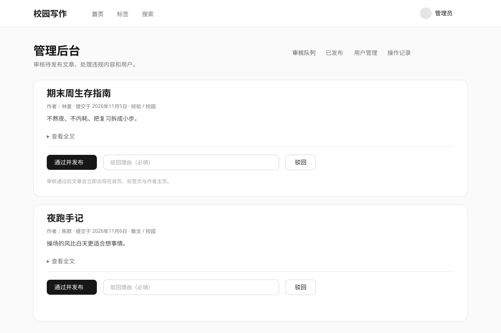

# 校园写作

面向校园的多作者写作平台：注册、写作、审核、发布、阅读。项目作为一份完整的全栈练手作品，覆盖认证、权限、内容状态机、审核后台、中文搜索与对象存储。

## 功能

- 邮箱注册 / 登录 / 退出，个人资料与头像
- Markdown 写作、实时预览、草稿、封面与标签
- 五态内容状态机：草稿 → 待审 → 已发布 / 已驳回 / 已下架
- 管理员审核队列、通过 / 驳回（必须填写理由）、已发布文章下架
- 用户管理：封禁 / 解封，封禁后无法登录且内容从公开页面隐藏
- 公开阅读：首页文章流与分页、文章详情、作者主页、标签页、站内搜索
- 内置评论：登录用户可在已发布文章下发表评论，作者或管理员可删除
- 审核操作留痕，管理员可查看操作记录
- 深色模式、空状态、加载态、错误边界与 404 页面

## 技术栈

| 层         | 技术                                            |
| ---------- | ----------------------------------------------- |
| 框架       | Next.js 15（App Router）+ React 19 + TypeScript |
| UI         | Tailwind CSS v4 + shadcn/ui + lucide-react      |
| 数据与认证 | Supabase（Auth + Postgres + Storage）           |
| 权限       | Postgres Row Level Security + 状态机触发器      |
| Markdown   | react-markdown + remark-gfm + rehype-sanitize   |
| 评论       | 内置 Supabase 评论表 + RLS                      |
| 部署       | Vercel / Cloudflare Workers（双配置）            |
| 测试       | Vitest + 集成验证脚本                           |

## 架构

```
浏览器
  |
  v
Next.js 15 (Vercel)
  +----------------------------------+
  | Server Components   读取公开数据 |
  | Server Actions      处理写入     |
  | middleware          刷新会话     |
  | requireActiveUser   路由保护     |
  +----------------+-----------------+
                   |
                   v
Supabase
  +----------------------------------+
  | Auth        注册 / 登录 / 会话   |
  | Postgres    业务数据 + RLS + 评论|
  | Storage     头像 / 封面          |
  +----------------------------------+
```

数据库设计、RLS 策略与状态机详见 [`docs/database.md`](docs/database.md)；审核流程详见 [`docs/moderation.md`](docs/moderation.md)。

## 内容状态机

```
                 submit                approve
   +-------+  ----------->  +---------+  -------->  +-----------+
   | draft |                | pending |             | published |
   +-------+                +---------+  <--------  +-----------+
       ^                         |        submit         |
       |                         | reject               | remove
       |                         v                      v
       |                    +----------+          +---------+
       +---- edit ----------| rejected |          | removed |
         (then resubmit)    +----------+          +---------+
                               edit -> resubmit
```

- 只有作者能把自己的草稿 / 被驳回 / 被下架文章提交审核。
- 只有管理员能通过、驳回或下架文章；驳回与下架必须填写理由。
- 只有 `published` 文章对公众可见。

## 页面预览

> 以下是界面布局示意，真实截图可在本地运行后补充。

| 首页                            | 文章页                               |
| ------------------------------- | ------------------------------------ |
|  |  |

| 我的文章                                 | 审核后台                             |
| ---------------------------------------- | ------------------------------------ |
|  |  |

## 本地运行

### 1. 环境要求

- Node.js 20+
- 一个 [Supabase](https://supabase.com) 免费项目

### 2. 安装依赖

```bash
npm install
```

### 3. 配置环境变量

复制 `.env.example` 为 `.env.local`：

```bash
cp .env.example .env.local
```

| 变量                            | 说明                                                 |
| ------------------------------- | ---------------------------------------------------- |
| `NEXT_PUBLIC_SUPABASE_URL`      | Supabase 项目 URL                                    |
| `NEXT_PUBLIC_SUPABASE_ANON_KEY` | Publishable key（等同于 anon key，公开）             |
| `SUPABASE_SERVICE_ROLE_KEY`     | Secret key（等同于 service role，仅服务端使用）      |
| `SUPABASE_ACCESS_TOKEN`         | Personal Access Token（`sbp_` 开头），仅迁移脚本使用 |

### 4. 建立数据库

推荐使用迁移脚本：

```bash
npm run db:push
npm run db:seed
```

如果无法使用 Management API，也可以把 [`supabase/manual-migrations.sql`](supabase/manual-migrations.sql) 的全部内容粘贴到 Supabase Dashboard 的 SQL Editor 执行一次，然后运行 `npm run db:seed`。

### 5. 启动

```bash
npm run dev
```

打开 http://localhost:3000。

## 演示账号

`npm run db:seed` 会创建以下账号（密码均为 `Campus123456!`）：

| 邮箱                | 角色   | 用途                               |
| ------------------- | ------ | ---------------------------------- |
| `admin@example.com` | 管理员 | 审核队列、下架、封禁用户、操作记录 |
| `lin@example.com`   | 作者   | 已发布 / 待审 / 已下架文章         |
| `chen@example.com`  | 作者   | 已发布 / 已驳回文章                |

演示数据包含 5 篇文章：2 篇已发布、1 篇待审、1 篇已驳回、1 篇已下架。

## 常用命令

| 命令                               | 作用                                       |
| ---------------------------------- | ------------------------------------------ |
| `npm run dev`                      | 启动开发服务器                             |
| `npm run build`                    | 生产构建                                   |
| `npm run start`                    | 启动生产服务器                             |
| `npm run lint`                     | ESLint 检查                                |
| `npm run typecheck`                | TypeScript 类型检查                        |
| `npm test`                         | Vitest 单元测试                            |
| `npm run format`                   | Prettier 格式化                            |
| `npm run db:push`                  | 执行数据库迁移                             |
| `npm run db:seed`                  | 写入演示数据（幂等）                       |
| `npm run db:query -- "select ..."` | 通过 Management API 执行只读 SQL           |
| `npm run verify:rls`               | 验证匿名 / 作者 / 管理员的权限边界         |
| `npm run verify:auth`              | 验证注册、资料更新、用户名唯一性、头像上传 |
| `npm run verify:posts`             | 验证文章状态机、审核、下架、封禁与审计日志 |
| `npm run verify:public`            | 验证首页 / 详情 / 作者 / 标签 / 搜索查询   |
| `npm run verify:comments`          | 验证评论读写与删除权限                     |
| `npm run preview`                  | 构建并本地预览 Cloudflare Worker           |
| `npm run deploy`                   | 构建并部署到 Cloudflare Workers            |

> 集成验证脚本会创建并清理临时用户与文章，需要 `.env.local` 中的 Supabase 配置。

## 部署

### Vercel

1. 将仓库推送到 GitHub，在 Vercel 中导入项目。
2. 在 Vercel 项目设置中配置环境变量：
   - `NEXT_PUBLIC_SUPABASE_URL`
   - `NEXT_PUBLIC_SUPABASE_ANON_KEY`
   - `SUPABASE_SERVICE_ROLE_KEY`
3. Build Command 保持 `npm run build`。
4. 部署后访问生产 URL，使用演示账号或注册新账号验证完整流程。

### Cloudflare Workers

项目同时保留了 OpenNext Cloudflare 配置：

```bash
npx wrangler login
npx wrangler secret put SUPABASE_SERVICE_ROLE_KEY

npm run preview   # 本地构建并用 Wrangler 预览
npm run deploy    # 构建并部署到 Cloudflare Workers
```

`NEXT_PUBLIC_*` 在构建时从 `.env.local` 内联；服务端密钥通过 Wrangler secret 注入。

> 网络提示：`vercel.app` 与 `workers.dev` 域名在中国大陆通常无法直接访问。免费境外托管无法同时满足“国内可访问”；需要国内访问时，应使用自定义域名/CDN、代理，或国内云 + ICP 备案。

Supabase 免费版项目在长时间闲置后会休眠，首次访问可能需要等待唤醒；可以添加定时请求保活。

## 项目结构

```
src/
  app/
    (auth)/register, (auth)/login
    posts/[slug]          文章详情
    authors/[username]    作者主页
    tags, tags/[slug]     标签
    search                搜索
    dashboard             我的文章 / 新建 / 编辑
    profile               个人资料
    admin                 审核、已发布、用户、操作记录
    api/health            Supabase 健康检查
  components/             布局、Markdown、编辑器、文章卡片、管理表单
  lib/
    auth/                 校验、权限、守卫、Server Actions
    posts/                状态机、校验、slug、查询、Server Actions
    moderation/           审核 / 封禁 Server Actions
    supabase/             浏览器端与服务端客户端
supabase/
  migrations/             表结构、索引、RLS 与触发器
  manual-migrations.sql   合并版，便于 SQL Editor 执行
scripts/                  迁移、种子与集成验证脚本
docs/                     数据库、审核文档与页面预览
open-next.config.ts       OpenNext Cloudflare 配置
wrangler.jsonc            Cloudflare Workers 配置
```

## 已知限制

- `vercel.app` 与 `workers.dev` 域名在中国大陆通常无法直接访问；免费境外托管无法保证国内可访问。
- 评论为纯文本，暂无敏感词过滤；依靠“登录后才能评论 + 作者/管理员删除”控制。
- 已发布文章允许作者直接编辑，改动即时生效，不会重新送审；管理员仍可下架。
- 站内搜索使用 `ILIKE` + `pg_trgm`，适合小规模数据；数据量增长后可替换为专用搜索引擎。
- 面向练手与作品集，不包含实名、复杂风控与运营级审核能力。
